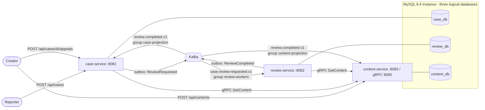

# Architecture

Event-driven content review and appeals platform: a complaint about content is reviewed asynchronously, restricted content can be appealed once, and each service owns its own database.

## Services

| Service | Owns | Responsibility |
|---|---|---|
| case-service | `case_db`: complaints/cases, appeals, idempotency keys, outbox, processed events | Accepts complaints and appeals over HTTP, enforces ownership, publishes `ReviewRequested`, applies `ReviewCompleted` to the case status |
| review-service | `review_db`: review decisions, outbox, processed events | Consumes `ReviewRequested`, looks up content over gRPC, applies the demo policy, publishes `ReviewCompleted` |
| content-service | `content_db`: content, processed events | Content API, gRPC metadata server, applies `ReviewCompleted` to content visibility |

Rules: services never read each other's databases; `contracts` holds only event DTOs and the protobuf definition (no entities or business logic); each service has its own Flyway migrations.

## Flow

1. Reporter files a complaint with an `Idempotency-Key`. case-service checks the content over gRPC, then in one transaction stores the case (`PENDING_REVIEW`, round 1) and an outbox row. Replaying the same key and payload returns the original result; the same key with a different payload, or a second complaint for the same content, is a 409.
2. The outbox relay publishes `ReviewRequested` (key `caseId`).
3. review-service (group `review-workers`, scaled by partitions) decides ALLOW or RESTRICT with a deterministic demo policy and publishes `ReviewCompleted`. The policy is a fixture, not a real moderation system: round 1 follows the content's `licenseValid` flag, round 2 uses the license-note fixture `APPEAL_EVIDENCE_OK`.
4. case-service and content-service consume `ReviewCompleted` in separate groups: the case becomes `DISMISSED` or `RESTRICTED`, and content visibility is updated.
5. The content creator may appeal a `RESTRICTED` case once. The case moves to `APPEAL_PENDING`, a round-2 request is published, and the outcome is `RESTORED` (round-2 ALLOW) or `RESTRICTION_CONFIRMED` (round-2 RESTRICT). Late round-1 results cannot overwrite an appeal in progress or its outcome.

## Reliability

See [events.md](events.md) for delivery guarantees. Summary: transactional outbox with leased, ordered batches and exponential backoff; idempotent consumers keyed by event id; per-group dead-letter topics with admin replay; bounded gRPC deadlines.

## Access control

HTTP Basic with three demo accounts (`reporter`, `creator`, `admin`), passwords only from environment variables. Reporters file complaints, only the content's creator can appeal, a case is readable by its reporter, its creator or an admin, and `/internal/**` plus non-health actuator endpoints are admin-only. This is demo-grade security: no TLS, no token service, no service-to-service credentials on gRPC.

## Observability

JSON logs with `service`, `caseId`, `eventId`, `reviewRound`, `correlationId`; `X-Correlation-Id` is propagated into events. Prometheus metrics at `/actuator/prometheus` (admin only), including `complaints.accepted`, `reviews.completed`, `kafka.consumer.processing`, `outbox.*`, retry and dead-letter counters.

## Deployment

- Docker Compose: `compose.yaml` (MySQL, single KRaft Kafka broker, topic init, three services).
- Kubernetes (kind): `k8s/base` with StatefulSets for MySQL and Kafka, a topic-init Job and Deployments (review-service runs 2 replicas).
- Limits: one Kafka broker (replication factor 1) and one MySQL instance with three logical databases, so no high availability; plaintext Kafka and HTTP. A real deployment would use separate database servers, a replicated Kafka cluster and TLS.

Measured behavior is in [results.md](results.md); versions are in [versions.md](versions.md).
